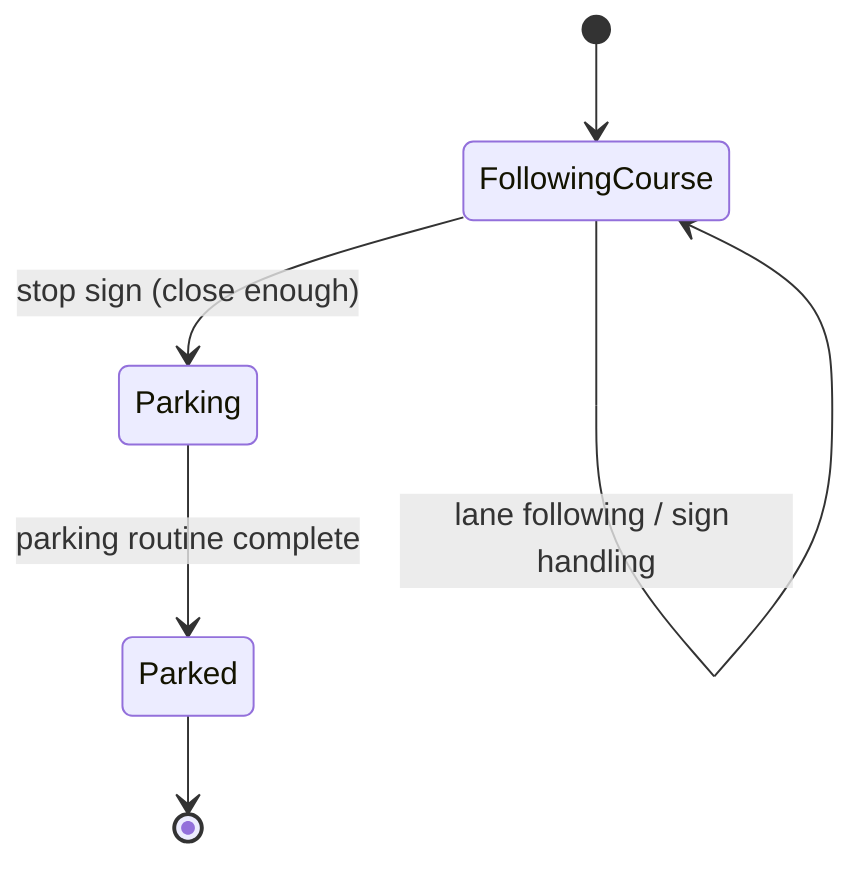

# AutoCar: Autonomous Lane-Following & Parking Robot


Firmware for a mecanum-wheeled model car. The car stays in its lane with a PID controller, reacts to traffic signs it recognizes on camera, and parks itself in a bay using time-of-flight range sensors.

---

## Contents

- [Features](#features)
- [Design Decision: PID Lane Keeping](#design-decision-pid-lane-keeping)
- [How It Works](#how-it-works)
- [Hardware](#hardware)
- [Project Structure](#project-structure)
- [Getting Started](#getting-started)
- [Configuration](#configuration)

---

## Features

- **PID lane following.** A closed-loop PID controller steers the car. The competition suggested direct arithmetic instead ([why PID?](#design-decision-pid-lane-keeping)).
- **Traffic-sign handling.** The car reacts to stop, go-straight, turn-left, turn-right and crosswalk signs.
- **Autonomous parking.** Strafing on the mecanum wheels, guided by VL53L1X time-of-flight sensors.
- **Driver feedback.** The speed limit and live range readings appear on a 16×2 RGB LCD.
- **Watering indicator.** An RGBW NeoPixel strip lights up when an object comes within 250 mm on the left.

---

## Design Decision: PID Lane Keeping

> **The competition's suggested approach:** use the camera to estimate the distance from the car to the left and right lane borders, then compute the wheel speeds directly from those two distances with a fixed formula.
>
> **This project uses a PID controller instead.**

### The suggested approach

The suggested method maps the current camera frame straight to a wheel speed:

$$
\text{left} = \text{base} - k\,(d_L - d_R), \qquad \text{right} = \text{base} + k\,(d_L - d_R)
$$

This is simple, but it is really *proportional-only* control. It reacts only to where the car is in this frame. It ignores how fast the car is drifting and how long it has been off-center.

### The approach used here

The same camera measurements become an **error** signal, and a PID controller turns that error into a steering correction ([`LaneFollower.cpp`](Robotic_car/LaneFollower.cpp), [`PidController.h`](Robotic_car/PidController.h)):

$$
e = d_L - d_R - \text{offset}, \qquad
u = \operatorname{clamp}\!\left(K_p\,e + K_i\!\int e\,dt + K_d\,\frac{de}{dt},\; \pm 100\right)
$$

$$
\text{left} = \text{base} - u, \qquad \text{right} = \text{base} + u
$$

### Why PID is the better choice

| | Direct arithmetic | PID |
|---|---|---|
| **Oscillation** | A high gain makes the car zig-zag across the lane; a low gain makes it slow to respond on curves. One gain cannot fix both. | The derivative term reacts to *how fast* the error is changing and brakes the correction before the car overshoots. This damps the zig-zag and allows a stronger, faster response. |
| **Timing** | The correction is applied once per frame, so the car's behavior shifts whenever camera or processing time varies. | The derivative and integral use the measured time step `dt`, so the response stays consistent as the loop rate changes. |
| **Steady drift** | Any constant bias, such as mismatched motors or an off-center camera, leaves a permanent offset. | The integral term can cancel a persistent bias, and a fixed `offset` adjusts the target line. |
| **Robustness** | A single bad frame can produce a sharp swerve. | The output is clamped (±100 PWM), so one noisy frame cannot make the car lurch violently. |
| **Tuning** | One magic number, adjusted by trial and error. | Three gains with separate, well-understood effects, so tuning is systematic: raise `Kp` until the car responds quickly, then add `Kd` to stop the overshoot. |
| **Reuse** | The formula is tied to one speed. | The same controller runs unchanged at cruise speed (150) and crosswalk speed (60). |

The tuned gains are `Kp = 0.79`, `Ki = 0` and `Kd = 0.045`. The proportional term does most of the steering, and the small derivative term supplies the damping that direct arithmetic lacks. The integral term was not needed on this track, so `Ki` is 0, but it is available in [`Config.h`](Robotic_car/Config.h) if a car shows steady drift.

---

## How It Works

The firmware runs a simple state machine, driven from `loop()` by `Mission::update()`:



### Traffic signs

A sign is only acted on once its *sign ratio* passes a threshold. The ratio is the sign's apparent size, so it grows as the car gets closer.

| Sign | ID | Trigger ratio | Response |
|---|---|---|---|
| Stop | 1 | ≥ 10 | Drive on for 0.5 s, stop, square up to the wall ahead, then park |
| Go straight | 7 | > 1 | Show `60km/h` and keep following the lane for 2 s |
| Crosswalk | 15 | > 1 | Side-step right, show `50km/h`, pass at reduced speed for 3 s |
| Turn left | 8 | ≥ 12 (first) / ≥ 35 | Arc left while the sign is visible, then hold the arc |
| Turn right | 9 | ≥ 20 | Creep forward, arc right while the sign is visible, then hold the arc |

### Parking routine

1. Strafe left until the left sensor reads < 250 mm.
2. Use the front sensor to settle 240–350 mm from the wall ahead.
3. Pivot left briefly to correct the heading.
4. Strafe right until the left clearance exceeds 135 mm, then stop.

---

## Hardware

| Component | Details |
|---|---|
| Microcontroller | Arduino UNO (ATmega328P) or compatible |
| Drivetrain | 4 × DC motors with mecanum wheels, 4-channel H-bridge (direction + PWM per channel) |
| Vision | Camera module driven by the `AutoCar` library (lane detection, MLP sign classifier) |
| Range sensors | 3 × VL53L1X time-of-flight sensors, I²C, short-distance mode |
| Lighting | 2 × Adafruit NeoPixel RGBW strips, 60 LEDs each |
| Display | Grove 16×2 RGB LCD, I²C |

### Pin map

**Motors.** The right-hand motors are mounted mirrored, so their direction logic is inverted in firmware.

| Wheel | Direction pin | PWM pin | Forward when direction pin is |
|---|---|---|---|
| Front left | 7 | 6 | `HIGH` |
| Rear left | 8 | 9 | `HIGH` |
| Front right | 4 | 5 | `LOW` |
| Rear right | 2 | 10 | `LOW` |

**Peripherals**

| Device | Role | Pin | I²C address |
|---|---|---|---|
| VL53L1X | Left-facing | XSHUT `A2` | `0x2A` |
| VL53L1X | Front-facing | XSHUT `A1` | `0x2B` |
| VL53L1X | Auxiliary (reserved) | XSHUT `A0` | `0x2C` |
| NeoPixel strip | Auxiliary | `3` | — |
| NeoPixel strip | Watering indicator | `11` | — |
| RGB LCD | Status display | I²C | Library default |

Every VL53L1X powers up at address `0x29`. At boot the firmware holds them all in reset, then wakes and re-addresses them one at a time.

---

## Project Structure

```
Robotic_car_2/
├── Robotic_car/                # Arduino sketch (folder name must match the .ino)
│   ├── Robotic_car.ino         # Entry point: wires up modules, setup() and loop()
│   ├── Config.h                # All pin assignments and tuning parameters
│   ├── Mission.h / .cpp        # State machine, sign handling and parking routine
│   ├── LaneFollower.h / .cpp   # PID lane keeping on top of the camera output
│   ├── PidController.h         # Generic clamped PID controller
│   ├── Drivetrain.h / .cpp     # Mecanum drive: tank drive, strafing, rotation
│   ├── RangeSensors.h / .cpp   # Bring-up and reading of the VL53L1X sensors
│   ├── StatusDisplay.h / .cpp  # LCD output
│   └── LightStrips.h / .cpp    # NeoPixel output
├── .clang-format
└── README.md
```

Hardware drivers (`Drivetrain`, `RangeSensors`, `StatusDisplay`, `LightStrips`) contain no mission logic, and `Mission` never touches pins directly. All tunable values live in `Config.h`.

---

## Getting Started

### Dependencies

| Library | Source |
|---|---|
| `Wire` | Bundled with the Arduino core |
| `VL53L1X` | [Pololu](https://github.com/pololu/vl53l1x-arduino), via the Library Manager |
| `Adafruit NeoPixel` | [Adafruit](https://github.com/adafruit/Adafruit_NeoPixel), via the Library Manager |
| `Grove - LCD RGB Backlight` (`rgb_lcd.h`) | [Seeed Studio](https://github.com/Seeed-Studio/Grove_LCD_RGB_Backlight), via the Library Manager |
| `AutoCar` | Vendor library supplied with the car kit (not included in this repository) |

### Build and upload

**Arduino IDE.** Open `Robotic_car/Robotic_car.ino`, select your board and port, then click **Upload**.

**arduino-cli**

```bash
arduino-cli lib install "VL53L1X" "Adafruit NeoPixel" "Grove - LCD RGB Backlight"
```

```bash
arduino-cli compile --fqbn arduino:avr:uno Robotic_car
```

```bash
arduino-cli upload --fqbn arduino:avr:uno --port /dev/ttyUSB0 Robotic_car
```

Serial output runs at **115200 baud**. If a range sensor fails to start, the firmware reports which one and halts.

---

## Configuration

Every tunable value lives in [`Robotic_car/Config.h`](Robotic_car/Config.h), grouped by subsystem. The main ones:

| Parameter | Default | Description |
|---|---|---|
| `kSteeringKp` / `kSteeringKi` / `kSteeringKd` | `0.79` / `0` / `0.045` | Lane-following PID gains |
| `kMaxSteeringCorrection` | `100` | Clamp on the PID output (PWM units) |
| `kLaneCenterOffset` | `5` | Bias applied to the lane-center target |
| `kCruiseSpeed` | `150` | Base PWM while lane following |
| `kCrosswalkSpeed` | `60` | Base PWM while passing a crosswalk |
| `kStopSignRatio`, `kLeftTurnRatio`, … | see file | How close each sign must be before the car reacts |
| `kPark*Mm` | see file | Distance targets for the parking routine |
| `kLedBrightness` | `100` | NeoPixel brightness (0–255) |

Source formatting follows the bundled [`.clang-format`](.clang-format) (Google style, 100 columns).
